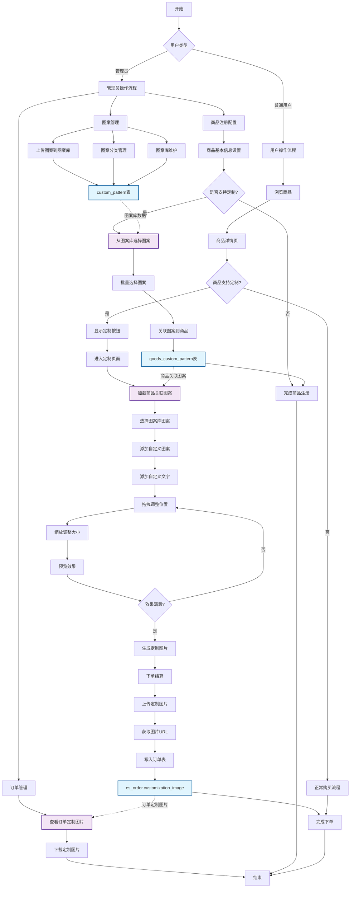

# 商品定制功能流程图

## 整体功能流程图



## 管理员图案管理流程

```mermaid
graph TD
    A[管理员登录] --> B[进入图案管理]
    B --> C{操作类型}
    
    C -->|上传图案| D单个图案上传]
    C -->|批量上传| E[文件夹批量上传]
    C -->|管理图案| F[图案列表管理]
    
    D --> D1[选择图片文件]
    D1 --> D2[设置图案信息]
    D2--> D3选择分类]
    D3 --> D4保存]
    
    E --> E1[选择文件夹]
    E1 --> E2[批量处理图片]
    E2 --> E3[设置分类信息]
    E3 --> E4批量上传保存]
    
    F --> F1[查看图案列表]
    F1--> F2{操作类型}
    F2 -->|编辑| F3[修改图案信息]
    F2 -->|删除| F4[删除图案]
    F2 -->|分类| F5[调整分类]
    
    D4--> G[图案库更新]
    E4--> G
    F3--> G
    F4--> G
    F5--> G
```

## 商品注册定制配置流程

```mermaid
graph TD
    A[商品注册页面] --> B[填写基本信息]
    B --> C[设置商品属性]
    C --> D{是否支持定制?}
    
    D -->|否| E完成商品注册]
    D -->|是| F[显示定制配置区域]
    
    F --> G[选择定制图案]
    G --> H[从图案库选择]
    H --> I[支持批量选择]
    I --> J[预览选定图案]
    J --> K{图案选择完成?}
    
    K -->|否| H
    K -->|是| L[保存商品配置]
    L --> M[关联图案到商品]
    M --> E
    
    E --> N[商品注册完成]
```

## 用户定制操作流程

```mermaid
graph TD
    A[用户浏览商品] --> B[商品详情页]
    B --> C{商品支持定制?}
    
    C -->|否| D正常购买流程]
    C -->|是| E[显示定制按钮]
    
    E --> F[点击定制按钮]
    F --> G[进入定制页面]
    
    G --> H[加载商品定制图案]
    H --> I[显示图案库]
    
    I --> J{操作类型}
    J -->|选择图案| K从图案库拖拽]
    J -->|上传图案| L[上传自定义图案]
    J -->|添加文字| M[添加自定义文字]
    
    K --> N[拖拽到画布]
    L --> N
    M --> N
    
    N --> O[调整位置大小]
    O --> P预览效果]
    P --> Q{效果满意?}
    
    Q -->|否| R[撤销/重做]
    R --> O
    
    Q -->|是| S[生成定制图片]
    S --> T[上传到服务器]
    T --> U[获取图片URL]
    U --> V[跳转结算页面]
    
    V --> W完成下单]
    W --> X[定制图片关联订单]
    
    D --> Y[正常购买完成]
    X --> Z[定制购买完成]
```

## 数据流转图

```mermaid
graph LR
    A[图案管理] --> B[custom_pattern表]
    B --> C[商品注册选择]
    C --> D[goods_custom_pattern表]
    D --> E[用户定制页面]
    E --> F[定制图片生成]
    F --> G[图片上传存储]
    G --> H[es_order.customization_image]
    
    I[商品信息] --> J[es_goods.is_customizable]
    J --> K[商品详情页显示]
    K --> E
    
    L[用户操作] --> M[Canvas操作]
    M --> N图片合成]
    N --> F
```

## 权限控制流程

```mermaid
graph TD
    A[用户访问] --> B{用户类型}
    
    B -->|管理员| C[管理员权限验证]
    B -->|普通用户| D[用户权限验证]
    
    C --> C1[图案管理权限]
    C --> C2[商品管理权限]
    C --> C3订单管理权限]
    
    D --> D1[商品浏览权限]
    D --> D2[定制功能权限]
    D --> D3[下单权限]
    
    C1 --> E[允许操作]
    C2--> E
    C3--> E
    D1--> E
    D2--> E
    D3> E
    
    E --> F[记录操作日志]
    F --> G[操作完成]
```

## 错误处理流程

```mermaid
graph TD
    A[操作执行] --> B{是否成功?}
    
    B -->|是| C正常流程]
    B -->|否| D[错误处理]
    
    D --> E{错误类型}
    E -->|权限错误| F返回权限错误]
    E -->|数据错误| G返回数据错误]
    E -->|系统错误| H返回系统错误]
    E -->|网络错误| I[返回网络错误]
    
    F --> J[显示错误信息]
    G --> J
    H --> J
    I --> J
    
    J --> K[记录错误日志]
    K --> L[错误处理完成]
    
    C --> M[操作成功]
```

---

## 流程说明

###1. 管理员操作流程
- **图案管理**：上传、分类、维护图案库
- **商品注册**：设置商品是否支持定制，选择关联图案
- **订单管理**：查看和下载用户定制图片

### 2 用户操作流程
- **商品浏览**：查看商品详情，判断是否支持定制
- **商品定制**：选择图案、添加文字、调整位置大小
- **下单结算**：生成定制图片，关联到订单

### 3. 数据流转
- 图案从管理端上传到图案库
- 商品注册时选择图案，建立关联关系
- 用户定制时只能看到商品关联的图案
- 定制图片最终关联到订单

###4. 权限控制
- 管理员拥有图案管理、商品配置、订单查看权限
- 普通用户拥有商品浏览、定制操作、下单权限
- 所有操作都有日志记录

###5 错误处理
- 完善的错误分类和处理机制
- 用户友好的错误提示
- 详细的错误日志记录 